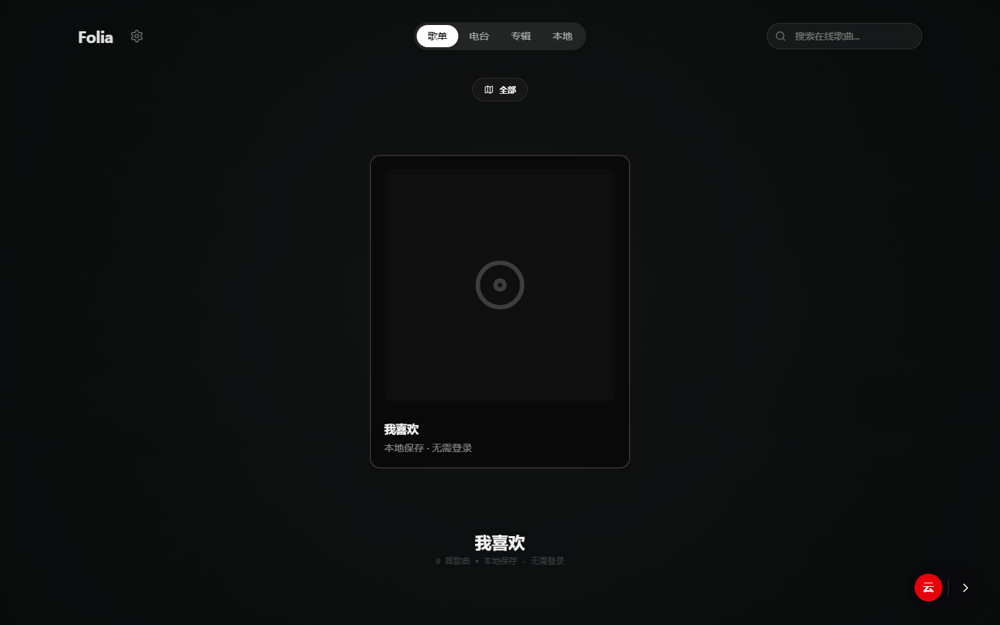
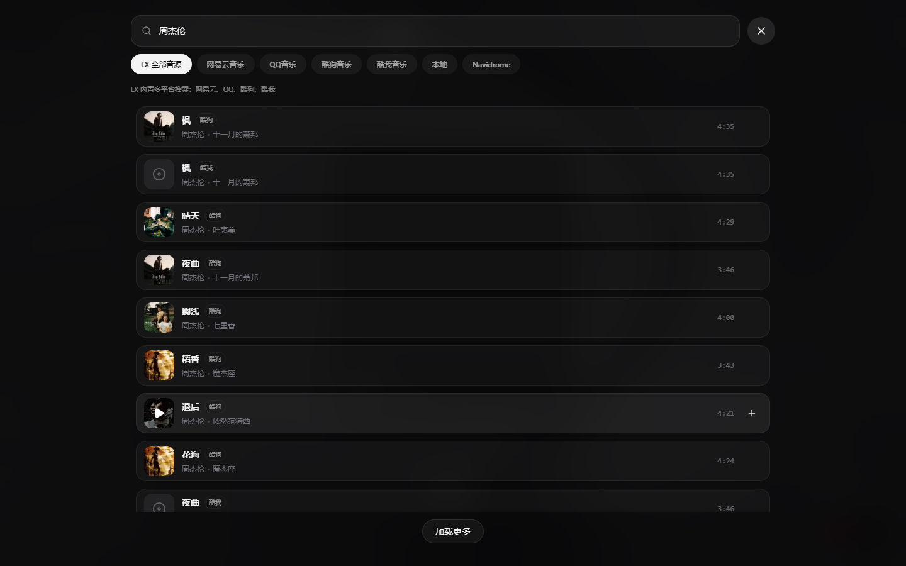
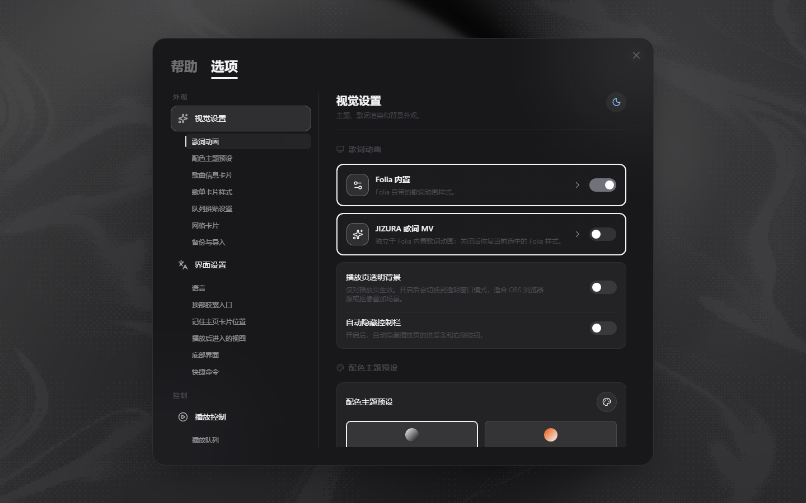

# Folia Windows · JS 音源版

这是一个以 Folia 交互界面为基础、面向 Windows 桌面使用场景改造的音乐播放器版本。

本版本把播放、搜索和歌词能力拆成可切换的通道：用户可以登录正版平台账号来读取账号资料和歌单，也可以直接使用本地加载的 LX Music 兼容 JS 音源。账号登录与播放模式相互独立，未登录时也可以使用音源通道和本地歌单功能。

## 当前版本提供的能力

- Windows Electron 桌面版，支持便携式运行。
- LX Music 风格的 JS 音源加载机制：启动时读取程序目录下的 `音源` 文件夹中的 `.js` 文件。
- 多平台搜索与分流：由音源自行提供平台搜索、歌曲详情、播放地址和歌词能力。
- 正版通道与音源通道手动切换，账号登录不会自动改变当前播放模式。
- QQ 音乐、网易云音乐、酷狗音乐、酷我音乐等平台账号连接，用于读取账号资料、歌单、收藏等内容。
- 不登录账号也可使用本地“我喜欢”、本地歌单、播放队列和歌单备份。
- Folia 内置歌词动画与 JIZURA 歌词 MV 两套独立渲染模式，二者可以在设置或播放控件中切换。
- JIZURA 支持随机样式、固定样式、逐首歌曲定制，以及画幅自适应，歌词时间轴会跟随当前播放歌词更新。
- 歌单、收藏、外观设置、Folia 歌词动画配置和 JIZURA 定制配置可以在“设置 → 备份与导入”中分别导出和导入。
- 支持本地音乐、封面、LRC/TTML 等歌词数据以及播放队列管理。

## 界面截图

以下截图来自当前 Windows 桌面版的本地运行界面。

### 本地歌单与“我喜欢”

未登录时也可以使用本地“我喜欢”和本地歌单。



### LX 多平台搜索

搜索页可以使用 LX 音源进行多平台搜索，并在结果中显示对应的平台来源。



### Folia 与 JIZURA 独立切换

视觉设置中可以分别控制 Folia 内置歌词动画和 JIZURA 歌词 MV。



### JIZURA 歌词 MV 定制

JIZURA 拥有独立的预览与编排工作台，可以分别调整风格、配色、氛围、编排和歌词组件。


## 播放模式说明

播放模式由用户手动选择：

| 模式 | 用途 |
| --- | --- |
| 正版通道 | 使用已连接平台的官方账号能力和对应平台播放接口。可见内容、播放权限和音质由平台账号及平台状态决定。 |
| 音源通道 | 使用 `音源` 文件夹中的 JS 音源搜索并获取播放资源。无需登录账号即可使用，但可用性取决于音源和外部平台接口。 |
| 本地 | 播放电脑上的本地音频文件。 |

登录 QQ、网易云、酷狗或酷我，主要是为了同步对应平台的用户信息、歌单和收藏，不是启用音源通道的前置条件。

## 音源目录

便携版目录结构如下：

```text
Folia/
├─ Folia.exe
└─ 音源/
   ├─ *.js
   └─ ...
```

启动时会自动加载 `音源/*.js`。添加或替换音源时：

1. 关闭 Folia。
2. 将兼容 LX Music 音源接口的 `.js` 文件放入 `音源` 文件夹。
3. 重新启动 Folia。
4. 打开设置中的 JS 音源页面，确认音源已加载并进行可用性检测。

音源来自第三方项目或个人维护，可能因为平台接口、版权策略、登录状态和网络环境发生失效。请只使用你有权访问的内容，并遵守相关平台服务条款。

## 下载 Windows 便携版

最新便携版发布在本项目的 GitHub Release：

- [Windows x64 便携版下载](https://github.com/ZAQ0405/folia-major-windows/releases/latest)
- [所有版本与更新记录](https://github.com/ZAQ0405/folia-major-windows/releases)

下载 ZIP 后解压，保持 `Folia.exe` 与 `音源` 文件夹处于同一目录，双击 `Folia.exe` 即可运行。便携版不会要求登录才能使用本地歌单和音源通道。

## 本地开发

环境要求：

- Windows 10/11
- Node.js 24 或更高版本
- npm

安装依赖：

```bash
npm install
```

启动 Electron 桌面开发版（支持热更新）：

```bash
npm run dev:electron
```

常用检查和构建命令：

```bash
npm run typecheck
npm run build
npm run build:electron:portable
```

便携版构建产物会生成在 `release-portable/`。构建脚本会将兼容音源复制到最终目录的 `音源/` 文件夹中。

## 项目结构

```text
src/services/jsMusicSource/         JS 音源加载、调用、缓存和歌词适配
src/services/onlineMusic/           正版平台与多平台搜索适配
src/components/visualizer/folia/   Folia 内置歌词动画
src/components/visualizer/jizura/  JIZURA 歌词 MV 引擎与定制配置
src/services/personalPlaylist*     本地歌单、我喜欢和歌单文件导入导出
src/services/settingsBackupService.ts 设置与歌词动画配置备份
packaging/windows/                  Windows 便携版打包脚本
音源/                                随程序分发的 JS 音源
```

## 备份与迁移

在“设置 → 备份与导入”中可以分别处理：

- 本地歌单和“我喜欢”歌曲数据；
- Folia 主题与内置歌词动画配置；
- JIZURA 歌词 MV 的随机、固定和逐首定制配置；
- 完整配置 JSON 或配置链接。

建议在更换设备或替换便携版前先导出备份。导入外部配置前请确认来源可信。

## 免责声明

本项目是个人学习、技术研究和非营利测试用途的软件改造项目。在线音乐、歌词、封面和账号数据的版权及相关权利归原平台和权利人所有。项目不保证第三方音源或平台接口持续可用，也不提供任何平台会员、破解或绕过授权服务。

使用者应自行遵守所在地法律法规、相关平台服务条款和版权要求，并在条件允许时通过官方渠道支持音乐创作者。

## 许可证与第三方组件

本项目沿用仓库中的 `AGPL-3.0` 许可证。JIZURA、音源及其他第三方组件分别遵循其原始项目附带的许可证或声明，请在分发和修改时一并保留对应文件。
